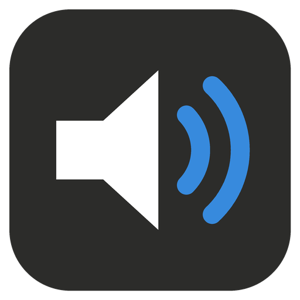

# ioBroker.airplay-receiver

[](https://www.npmjs.com/package/iobroker.airplay-receiver)
[](https://www.npmjs.com/package/iobroker.airplay-receiver)
[](LICENSE)

[](https://nodei.co/npm/iobroker.airplay-receiver/)


## AirPlay receiver adapter for ioBroker

Turns the voice satellites of [ioBroker.assistant](https://github.com/ioBroker/ioBroker.assistant) into AirPlay
speakers. An iPhone, iPad or Mac shows every configured satellite in its AirPlay list; music sent there plays on the
satellite's media player, for example a
[Waveshare ESP32-S3-AUDIO board](https://www.waveshare.com/wiki/ESP32-S3-AUDIO-Board) running ESPHome.

```
iPhone ──AirPlay 1 (RTSP/RTP, ALAC)──▶ adapter ──▶ ffmpeg ──FLAC/MP3 over HTTP──▶ satellite
                                          └── writes assistant.0.satellites.<room>.controls.<player>.url
```

- **Nothing to install on the system.** mDNS (Bonjour) is pure JavaScript, ffmpeg comes with the adapter
  ([ffmpeg-static](https://github.com/eugeneware/ffmpeg-static)). No Docker, no shairport-sync, no avahi needed.
- **No clicks on Wi-Fi.** Lost UDP packets are asked for again (twice) before a gap is played as silence.
- **Volume and title.** The AirPlay volume sets the satellite's volume, artist and title go to its display.
- **AirPlay 1 only.** Current iPhones and Macs still stream to AirPlay 1 speakers. AirPlay 2 features (multi-room
  sync with HomePods, the Home app) are not available.

## Requirements

- ioBroker.assistant 1.4.10 or newer with a satellite whose media player has the state
  `assistant.0.satellites.<satellite>.controls.<player>.url`.
- The iPhone and the ioBroker host in the same network (mDNS does not cross routers).
- The satellite must reach the HTTP port of the adapter (default 8095).

## Settings

### Speakers

One row per AirPlay speaker:

| Column           | Meaning                                                                                         |
| ---------------- | ----------------------------------------------------------------------------------------------- |
| AirPlay name     | Name in the AirPlay list of the iPhone, e.g. `Gast`                                              |
| Satellite player | `<satellite>.<player>`, e.g. `Gast.waveshare_voice_eb1614` — the list offers every player found |
| Format           | FLAC (lossless, little CPU on the satellite) or MP3                                             |
| RTSP port        | 0 = any free port (announced via mDNS); set a fixed port only for a firewall rule               |

Without any row, _one speaker for every satellite with a media player_ creates a speaker per satellite, named after
the satellite.

### Settings

| Setting                                 | Default       | Meaning                                                                                  |
| --------------------------------------- | ------------- | ---------------------------------------------------------------------------------------- |
| Instance of ioBroker.assistant          | `assistant.0` |                                                                                          |
| HTTP port of the stream / Listen on     | 8095, all     | The satellite fetches `http://<host>:8095/<name>.flac`                                   |
| Address of this host for the satellite | empty         | Empty = the address the iPhone reached; set it if ioBroker has several networks          |
| Sample rate, channels                   | 48 kHz, mono  | What the satellite plays; the Waveshare firmware declares 48 kHz mono                     |
| Volume of the sender sets the satellite | on            | AirPlay -30…0 dB → `controls.<player>.volume` 0…1, mute → 0                              |
| Wait for a lost packet                  | 350 ms        | How long a gap waits for its retransmission                                              |
| Audio kept until the satellite connects | 1500 ms       | The beginning of a song is not lost while the satellite opens the stream                 |
| Stop the satellite after a pause of     | 15 s          | Short pauses keep the stream open (silence); a longer pause stops the satellite          |
| Path of ffmpeg                          | empty         | Empty = the bundled ffmpeg                                                               |

## What happens

1. The adapter announces `_raop._tcp` for every speaker. The name on the iPhone is the AirPlay name.
2. The iPhone connects (RTSP), sends the encrypted session key and starts streaming ALAC over UDP.
3. When audio arrives the adapter writes the stream URL into `controls.<player>.url`; ioBroker.assistant sends it to
   the satellite, which opens the HTTP stream. Each listener gets its own ffmpeg, which turns ALAC into FLAC or MP3.
4. Volume changes on the iPhone go to `controls.<player>.volume`, artist and title to `controls.media_title` (if
   the satellite has that state).
5. Stop on the iPhone, another speaker chosen, or a pause longer than the stop time: the adapter writes `stop`.

The latency is about 2–3 seconds (the satellite buffers the HTTP stream). Video on the iPhone is not delayed to match.

## States

For every speaker below `airplay-receiver.0.receivers.<name>`:

| State       | Meaning                                       |
| ----------- | --------------------------------------------- |
| `connected` | A sender is connected                         |
| `playing`   | Audio is arriving                             |
| `client`    | Name of the sender (iPhone)                   |
| `title`     | Track title                                   |
| `artist`    | Artist                                        |
| `album`     | Album                                         |
| `volume`    | Volume of the sender, 0–100 %                 |
| `streamUrl` | The URL the satellite fetches                 |

`info.connection` is true while the speakers are announced.

## Troubleshooting

| Symptom                                  | Cause and remedy                                                                                       |
| ---------------------------------------- | ------------------------------------------------------------------------------------------------------ |
| The speaker does not show up             | iPhone and ioBroker in different networks or VLANs; a firewall blocks UDP 5353 (mDNS)                   |
| It shows up, but nothing plays           | Look at the log: does the adapter write the URL? Can the satellite reach port 8095 of the ioBroker host? |
| The iPhone connects and drops at once    | A firewall blocks the RTSP port or UDP; set a fixed RTSP port and open it together with UDP            |
| Wrong address in the stream URL          | Set _Address of this host for the satellite_                                                            |
| Dropouts                                 | Weak Wi-Fi of the satellite; raise _Wait for a lost packet_                                             |

## Provenance

The protocol code is written for this adapter from public protocol descriptions. The AirPort Express RSA key in
`lib/airport-key.js` has been public since 2011 and is used by every open AirPlay 1 receiver; projects such as
shairport-sync and nodetunes served as protocol reference only. AirPlay is a trademark of Apple Inc.; this adapter is
not affiliated with Apple.

## Changelog

<!--
    Placeholder for the next version (at the beginning of the line):
    ### **WORK IN PROGRESS**
-->

### 0.0.1 (2026-11-05)

- (sadam6752-tech) First version: every voice satellite of ioBroker.assistant becomes an AirPlay speaker for iPhone,
  iPad and Mac

## License

MIT License

Copyright (c) 2026 sadam6752-tech <sadam6752@gmail.com>

Permission is hereby granted, free of charge, to any person obtaining a copy
of this software and associated documentation files (the "Software"), to deal
in the Software without restriction, including without limitation the rights
to use, copy, modify, merge, publish, distribute, sublicense, and/or sell
copies of the Software, and to permit persons to whom the Software is
furnished to do so, subject to the following conditions:

The above copyright notice and this permission notice shall be included in all
copies or substantial portions of the Software.

THE SOFTWARE IS PROVIDED "AS IS", WITHOUT WARRANTY OF ANY KIND, EXPRESS OR
IMPLIED, INCLUDING BUT NOT LIMITED TO THE WARRANTIES OF MERCHANTABILITY,
FITNESS FOR A PARTICULAR PURPOSE AND NONINFRINGEMENT. IN NO EVENT SHALL THE
AUTHORS OR COPYRIGHT HOLDERS BE LIABLE FOR ANY CLAIM, DAMAGES OR OTHER
LIABILITY, WHETHER IN AN ACTION OF CONTRACT, TORT OR OTHERWISE, ARISING FROM,
OUT OF OR IN CONNECTION WITH THE SOFTWARE OR THE USE OR OTHER DEALINGS IN THE
SOFTWARE.
